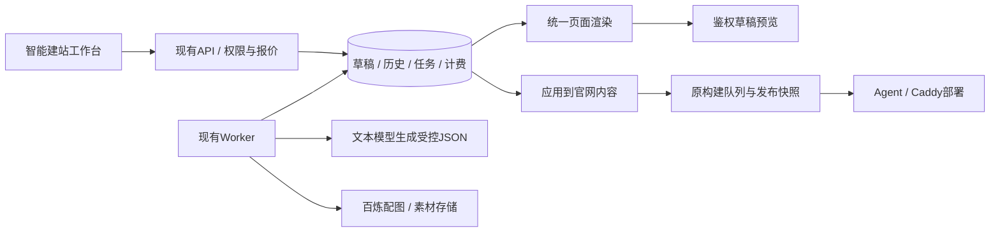

# AI 智能建站简易版

本功能纳入 v1.3.9。发布源码不代表生产已部署；真实供应商验收需独立完成。

## 使用流程

1. 登录发布中心，在“网站运营 → AI 智能建站”选择已创建的网站。
2. 选择商务蓝、亲和绿或简约黑风格，描述企业官网需求。系统会读取该客户知识库、地区与重点词。
3. 可勾选生成一张首页图。系统报价后再提交任务；不勾选时保留已有首页图，新草稿可无图。
4. 等待生成完成，在右侧切换桌面/手机预览，点击导航可查看企业简介、服务、案例、联系及原文章页面。
5. 继续输入修改指令，或在“页面细节”调整标题、介绍、颜色与SEO；通过复选框、上下箭头调整首页模块。
6. 可在预览工具栏选择历史草稿，对比修改前后的页面。预览历史版本不会恢复或修改当前草稿。
7. “保存到官网”将最新建站草稿应用为官网编辑内容；“保存并发布网站”应用后提交原有构建队列。
8. 发布状态、线上访问及回滚继续使用“发布与版本”。回滚发布包不会修改当前建站草稿或企业编辑资料。

## 第一版能力与边界

- 三套风格为同一受控页面系统的设计预设，支持主色、留白、卡片样式变化，并非自由代码生成器。
- 首页提供企业简介、产品与服务、服务优势、客户案例、联系我们五类模块，至少显示两类；首页大图独立生成。
- 生成首页及四个企业页面。文章列表与文章详情现由建站公共主题渲染，文章输出路径沿用绑定模板，原文章、统计脚本、域名与部署关系保留。
- 初次使用先由现有“创建网站”登记企业及域名，再进入建站模块；本版本不自动注册域名、修改DNS或创建客户服务器。
- 企业名称、联系电话、备案号来自当前客户/官网资料；AI不能通过页面配置修改客户归属、账号、服务器或备案链接。
- 自动生成或修改后先形成独立草稿；用户应用、发布后才影响官网，原图文文章的自动发布流程不变。
- 未接入万小智SaaS，不依赖其预览链接或账号；生成供应商复用当前DeepSeek兼容接口与百炼图片接口。

## 演示与真实模型

无文字模型凭据时，使用明确标记的本地演示。演示可体验生成、预览、模块手动调整、发布及以下自然语言指令：

- “主色改成蓝色/绿色/橙色/紫色/黑色/红色”或明确六位颜色值。
- “首页标题改为……”；“精简首页介绍”。
- “隐藏案例模块”；“恢复客户案例”；“产品与服务放到前面”。

演示不会理解任意需求，界面会提示这一点。图片也未配置时，首页图使用本地演示配图。已有真实文字模型时可不选图片单独生成；选择配图则需配置真实百炼图片模型，避免混合演示内容按真实服务收费。

真实配置复用已有 `AI_TEXT_BASE_URL`、`AI_TEXT_API_KEY`、`AI_TEXT_MODEL` 及 `ALIYUN_IMAGE_*`。真实模型调用、图片下载、OSS公网读取需使用真实配置另行验收。本地专项测试仅使用demo及mock供应商，不产生真实上游费用。

## 计费

简易版不另增建站价格字段。每次真实生成/对话修改按现有一次文章文字单价计费，首页图按当前每张图片单价计费（0或1张），提交前明确显示报价；手动调整与预览免费。正式模式仍需管理员启用价格、配置余额与客户预算。

生成任务与费用预占在同一数据库事务登记，成功草稿与扣款同事务保存。重复请求编号不会重复创建任务或收费。超时、网络中断或Worker失联时保留待核查账单，不自动重发模型调用；管理员在“余额与账单”核查并释放后可继续操作。

## 架构

生成任务保存在数据库，由现有Worker轮询；不额外增加容器。不同站点可并行生成，同站点不允许同时生成或编辑草稿。应用时检查官网内容和草稿版本，避免覆盖其他人的更新。

迁移 `011_website_builder.sql` 新建草稿、历史与任务表。API与Worker升级前须按现有migrate流程应用迁移。

## 文件与验证

- `pilot/ai-website.mjs`：建站需求校验、演示与真实文本生成。
- `pilot/website-renderer.mjs`：受控配置校验、三套风格与五页渲染。
- `pilot/website-builder.mjs`：API、权限、草稿版本、预览与任务执行。
- `public/website-builder-ui.js`、`public/website-builder.css`：工作台。
- `npm run test:website`：隔离数据库验证草稿、预览、发布快照、跨代理商拒绝、图片入库、收费及超时恢复。
- `npm test`、`npm run test:billing`、`npm run test:permissions`：原发布与计费权限回归。
