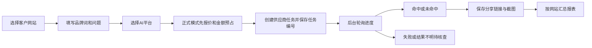

> v1.4.0已实现正式适配器与单次闭环；本文件保留前期分析。当前实现与配置请阅读[GEO单次查询闭环](GEO单次查询闭环.md)和[v1.4.0后端参考](v1.4.0-后端架构与API参考.md)。真实付费任务及云端OSS尚未联合验收。

# GEO查询与AI数据中心：实现方案

## 现有能力与新增能力

原GEO接口负责接收外部文章并触发官网发布。新增GEO查询负责观察AI回答是否命中企业品牌，二者独立。

## UI草图

页面包含数据报表、发起查询、查询记录三个入口；顶部四张统计卡片，下方平台命中情况及最近七天趋势。独立草图为本目录GEO查询UI草图.html。草图数据明确为演示。

## 本地首版

迁移015建立geo_query_tasks；GET/POST /api/geo-query按siteFor校验网站范围。页面AI数据中心支持多平台演示查询、记录分页和统计。演示记录具有mode=demo标识；无真实截图和分享链接时展示空态。没有数据时不绘制虚构占比。当前报表只统计本地演示记录，不能作为真实品牌可见度报告。

## 真实接入边界

已知查询进度接口POST /api/geo/check_task，需要api_key和request_id，返回平台、问题、品牌词、status、share_url、img_url等。新建任务文档当前访问失败，未猜测创建接口字段、收费金额和任务取消/退款规则。真实查询提交服务端保持关闭；后续核实新建任务契约、报价、金额预占、超时不重发、后台轮询以及截图持久化后再开放。当前没有新增付费调用，也未部署生产。

截图与命中仅反映一次查询时间、问题与平台的观察结果，不等于搜索引擎收录或长期排名保证。各平台支持范围须以供应商接口返回为准。

图表UI增量：新增各平台品牌命中占比环形图、各平台查询总数/品牌命中数对比柱形图，与现有七天趋势同时保留。按平台ID关联统计，使用真实记录中的计数，零命中显示灰色空环与无占比；灰色/浅色柱代表查询总数，实色柱代表命中数。UI草图单独使用明确标记的示例数据。无需数据库迁移。

正式闭环代码增量已实现，最新配置与验收边界见GEO单次查询闭环.md。迁移016，复用external-worker；默认仍为免费演示，正式单价未设置时禁止付费提交。
