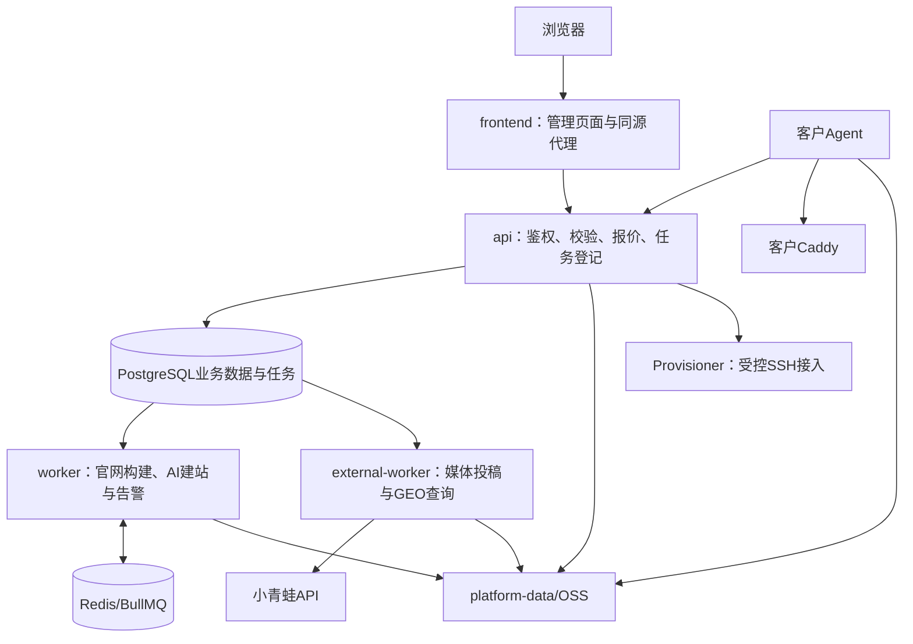

# 数告星发布中心 v1.4.0：后端架构与API参考

版本v1.4.0｜2026-11-07。本文依据pilot/、agent/、provisioner/及compose.production.yml描述实际实现。生产服务器的运行版本需单独核实。路径中的:id、:siteId为占位符，字段大小写按各接口实现保留。

## 1. 技术边界

Node.js 24原生ESM HTTP服务；PostgreSQL 18.6及以上稳定版保存业务事实；Redis/BullMQ负责官网构建队列。建站与外部服务另有PostgreSQL持久任务调度。静态管理前端由独立Caddy容器提供，API负责会话、授权、事务与业务入口。



浏览器不连接数据库或供应商API。客户Agent主动访问主控；主控不依赖开放客户Agent公网管理端口。Caddy管理地址应在客户机回环接口，不对公网开放。

## 2. 容器与数据协作

| 服务 | 职责 | 依赖和数据 |
| --- | --- | --- |
| postgres | 账号、内容、版本、金额、任务、统计 | postgres-data持久卷 |
| redis | BullMQ构建队列与调度状态 | redis-data持久卷 |
| migrate | 顺序执行SQL迁移 | 完成后退出；API和Worker依赖其成功 |
| api | 管理API、Webhook、Agent接口、媒体读取 | PostgreSQL、配置、platform-data/OSS |
| frontend | 静态管理页面与同源代理 | API_UPSTREAM指向api:3000 |
| worker | 官网构建与建站任务、发布outbox、告警 | PostgreSQL、Redis、共享platform-data |
| external-worker | 媒体订单与GEO阶段任务轮询 | external profile；PostgreSQL、供应商、共享platform-data/OSS |
| provisioner | 指纹、预检、安装与回连流程执行 | provisioning profile；隔离网络，内存凭据 |
| 客户Agent/Caddy | 应用网站发布包、版本切换、站点访问 | 在客户机器独立运行，不在主控Compose内 |

API、worker与external-worker使用同一DATA_ROOT=/data共享卷；本地截图由API通过/objects读取，不能只存在external-worker容器可写层。使用OSS时三者配置须一致。migrate不承担长期后台任务。

## 3. 源码地图

| 模块 | 文件 |
| --- | --- |
| HTTP与会话 | pilot/server.mjs、common.mjs、permissions.mjs |
| 数据库与迁移 | pilot/db.mjs、pilot/migrations/*.sql |
| 发布与部署 | publishing.mjs、worker.mjs、agent-api.mjs、agent/agent.mjs |
| 模板协议与渲染 | templates.mjs、template-upload.mjs、website-protocol.mjs、website-renderer.mjs |
| AI图文 | ai-article.mjs |
| AI建站 | website-builder.mjs、ai-website.mjs、website-conversation.mjs |
| 金额 | billing.mjs |
| 工作台与统计 | workspace.mjs、analytics.mjs |
| 媒体投稿 | external-publishing.mjs、external-provider.mjs |
| GEO查询 | geo-query.mjs、geo-workflow.mjs、geo-provider.mjs |
| 外部执行器 | external-worker.mjs |
| 存储 | 根目录storage-adapter.mjs |
| SSH接入 | pilot/provisioning.mjs、provisioner/ |
| 备份告警 | scripts/backup.mjs、pilot/alerts.mjs |

## 4. 数据库与迁移

数据库迁移通过schema_migrations记录，事务和advisory lock避免重复并发执行。生产不能依靠API启动时临时补字段；升级须先运行migrate。

| 版本增量 | 表或字段 | 用途 |
| --- | --- | --- |
| 既有001～011 | 客户、站点、文章、模板、服务器、发布/部署任务、会话、金额、访问统计、知识库、建站任务 | 既有主业务 |
| 012 | website_builder_messages | 对话、修改范围、版本与差异 |
| 013 | external_channel_cache、external_publish_quotes/batches/orders | 渠道缓存、冻结稿件、多渠道订单 |
| 014 | 外发报价article_id外键调整 | 原文章删除后保留快照 |
| 015 | geo_query_tasks | GEO查询记录 |
| 016 | geo_query_prices、geo_query_quotes、任务阶段/账单/租约/截图字段 | 正式闭环 |
| 017 | enabled_platforms及20分初始单价 | 逐平台开关 |

修改结构必须新增迁移，不能编辑已经在生产执行的SQL来替代迁移。schema_migrations当前应包含17个顺序文件。

## 5. 统一请求、授权与错误

管理接口/api/*使用session Cookie。POST /api/login接收username、password，成功设置HttpOnly、SameSite=Strict、8小时会话；生产COOKIE_SECURE=true。停用账号撤销会话。前端同源代理转发Cookie，客户端无需读取Cookie值。

除登录等公开入口外，账号须有效且agency账号有有效归属。siteFor检查网站所属客户的代理商范围；管理员操作额外检查role=admin。写请求存在Origin头时须与当前Host一致。

JSON请求Content-Type:application/json，通用请求体上限8MB。成功响应直接为业务对象或数组，不统一包data。失败形如：

```json
{"error":"报价已过期，请重新报价","billingStatus":"review","billingOrderId":"BILL_ID"}
```

后两个字段只在相关金额错误中出现。常见状态400参数错误、401未登录、403越权、402余额/预算不足、404不存在、409冲突、429限流、503未配置。202代表已受理，不代表部署或供应商执行完成。

登录、图文、外发、GEO等有不同限流。客户端不要通过高频轮询替代后台调度；GEO页面约10秒刷新记录，Worker按任务next_run_at调度。

## 6. 登录、全局状态与工作台

| 方法 | 路径 | 请求/返回 |
| --- | --- | --- |
| POST | /api/login | {username,password} → {id,name,role}及Cookie |
| POST | /api/logout | {} → {ok:true}，清会话 |
| GET | /api/state | 当前用户、permissions、客户网站、文章、模板、版本、任务等权限内状态 |
| GET | /api/workspace | {pageviews,aiArticles,spentCents,availableCents,scope,asOf} |
| GET | /health | 数据库连通、版本和queue标识；不代表所有供应商可用 |
| GET | /api/video/capabilities | {enabled:false,status:"planned",message} |

工作台PV为北京时间近7天汇总；AI文章为当月仍存在的AI生成文章；消费为本月扣款减退款流水，不能把该数直接当供应商成本。

## 7. 网站、文章、知识库与素材

| 方法 | 路径 | 主要字段/效果 |
| --- | --- | --- |
| POST | /api/sites | admin；name、client、agency、domain → {id}，201 |
| POST | /api/sites/:id/regions | name、domain、region、targetKeywords → {id}，201 |
| POST | /api/sites/:id/content | 受支持官网内容字段；合并草稿、revision+1 |
| POST | /api/sites/:id/articles | id可选，title、summary、body、format、status、SEO字段；保存文章 |
| POST | /api/sites/:id/articles | {id,remove:true}删除；外发快照保留 |
| POST | /api/sites/:id/media | {name,data:"data:image/png;base64,..."} → {id,site,key,url,size,width,height,driver,...} |
| GET | /api/clients/:id/knowledge | [{id,category,title,content,terms,updated_at,...}] |
| POST | /api/clients/:id/knowledge | id可选、category/title/content/terms；remove:true删除 |
| GET | /api/sites/:id/analytics?days=30 | 访问统计；days允许7、30、90 |
| POST | /api/sites/:id/analytics/domains | domains数组或分隔文本 → {ok,domains,republishRequired:true} |
| POST | /api/public/analytics/collect | 静态页面采集入口，不使用管理Cookie；校验绑定域名与采集字段 |

文章format=html时经过safeHtml。图片支持PNG/JPEG/WebP原图不超过5MB，限制像素并转换WebP。地区站共享客户知识库，但不复制原文章、发布历史和服务器绑定。

## 8. 官网发布与预览

POST /api/sites/:id/publish，body={}；冻结官网内容、文章和模板引用，创建发布/构建任务，返回202。后台构建完成后安排Agent部署。POST /api/sites/:id/rollback，body={id:目标发布版本}，生成部署切换任务；不覆盖当前运营草稿。

GET /preview/:siteId/及静态子资源：登录用户查看网站当前构建版本。GET /api/draft-preview/:previewId/...：已创建的模板草稿预览，校验创建者、过期时间与网站范围。预览使用CSP sandbox限制，不代表线上域名可访问。

| 管理接口（均POST） | 字段 | 作用 |
| --- | --- | --- |
| /api/infrastructure/bind | site、server | 网站绑定客户节点 |
| /api/infrastructure/retry | task | 重试失败部署，核对归属 |
| /api/infrastructure/builds/retry | job | 重试失败构建 |
| /api/infrastructure/templates/preview | site | 创建草稿预览，201 |

## 9. AI图文接口

POST /api/sites/:id/ai-quote，传imageCount（正文图1～3张，另含封面）；返回amountCents、configured、demo、price。正式生成须携带quoteVersion和quotedAmountCents。

POST /api/sites/:id/ai-articles：topic、keywords、region、tone、targetLength、imageStyle、imageCount、requestKey、quoteVersion、quotedAmountCents。返回202及article、release、mode、imageMode、imageCount、billing。该现有接口仍在API请求生命周期内执行模型与图片流程，不应误写为全部已迁移到外部Worker。

文字和图片模型配置相互独立。混合真实/演示模型会阻止计费。文章持久化与扣款在事务内完成，发布排队失败会提示手动发布；不能因为发布队列异常再次收费生成同一篇文章。

## 10. AI建站接口

前缀/api/sites/:id/website。

| 方法/后缀 | 输入 | 输出/行为 |
| --- | --- | --- |
| GET 根路径 | 无 | draft、jobs、versions、messages、siteRevision、themes、knowledgeCount、textMode、imageMode |
| POST /quote | 建站输入，imageCount=0或1 | 金额与价格版本 |
| POST /jobs | instruction、target、revision、主题及报价字段、requestKey | jobId、status、amountCents，202 |
| POST /draft | spec与revision等编辑字段 | 保存结构化草稿新版本 |
| POST /undo | revision等版本字段 | 复制上一版为新草稿 |
| POST /apply | revision、siteRevision | 应用官网草稿，后续单独发布 |
| GET /preview/... | revision可选 | 草稿渲染资源，不发布 |

实际建站输入由ai-website.mjs的websiteInput规范化；字段/版本校验以website-builder.mjs为准。上下文只携带受限历史，后端对指定target做范围合并。作业租约失联不得盲目重发供应商。

## 11. 员工与基础设施

GET /api/team读取可管理员工。POST /api/team：action=create时{name,username,password,agency}；agency账号忽略跨代理商指定，使用自身归属；action=status时{id,disabled}。不能停用当前账号。

以下基础设施接口仅admin：

| 方法/路径 | 主要输入 |
| --- | --- |
| POST /api/infrastructure/agencies | name、username、password、level |
| POST /api/infrastructure/servers | name、ipAddress；返回一次性Agent token |
| POST /api/infrastructure/servers/ip | server、ipAddress |
| POST /api/infrastructure/templates/import | source、name；受配置导入目录约束 |
| POST /api/infrastructure/templates/upload | application/zip原始二进制内容；查询参数name指定模板名称 |
| POST /api/infrastructure/templates/bind | site、template |
| POST /api/infrastructure/storage/check | 存储读写、匿名/签名访问探测，会写入后清理测试对象 |

Agent token只应在登记与客户安装时使用，不暴露给代理商。服务器名称、IP和Linux用户名分别是不同信息。

## 12. SSH自动接入接口

| 方法/路径 | 用途 |
| --- | --- |
| GET /api/provisioning | executor状态及接入任务 |
| POST /api/provisioning/host-key | {host,port}获取指纹 |
| POST /api/provisioning/preflight | requestKey、name、host、port、username、fingerprint、password或privateKey |
| GET /api/provisioning/:jobId | 查询执行器任务并同步 |
| POST /api/provisioning/:jobId/install | confirmed:true、fingerprint；二次确认安装 |
| POST /api/provisioning/:jobId/cancel | 在允许状态取消 |
| POST /api/provisioning/:jobId/revoke | confirmed:true；仅无网站绑定时撤销凭据 |

Provisioner只支持受配置白名单和固定指纹约束的空闲Ubuntu 22.04/24.04 x86_64 root/systemd主机。凭据在执行器内存暂存10分钟，不落任务表。已有业务/端口冲突阻止安装，不应将失败描述为已接入。

## 13. 金额接口

GET /api/billing返回accounts、orders、entries、clients、prices、currency。金额字段为整数分，余额与预占可能是数据库bigint字符串，前端显示时按需要转换。

POST /api/billing仅admin进行资金/规则写入：

| action | 字段 | 行为 |
| --- | --- | --- |
| prices | article、image、video（金额字符串）、enabled | 修改图文/视频预留价格版本 |
| recharge | account、amount、note、requestKey | 充值追加流水，重复请求校验金额 |
| client | client、direct、limit | 设置客户结算方式和月预算；处理中禁止改归属 |
| resolve | order、decision:"release"、note | 核查释放不确定任务，非直接重发 |
| refund | order、note | 对已扣款订单人工全额退款一次 |

预占、扣款、释放、退款与余额更新在事务中处理，流水表禁止修改和删除。金额来源于服务器报价，不信任前端传入单价。

## 14. 外部媒体接口

GET /api/external/channels：page=1、pageSize=12（12/24/48）、search、field_1～field_9、sort=asc/desc。返回items、page、pageSize、mode、facets、hasMore、cached、provider等；mock还有total。真实筛选范围filterScope=page，不支持已验收的全库筛选。

POST /api/external/quote：{site,article,channels:[媒体ID]}，1～10个唯一渠道；返回quoteId、mode、article快照、channels、amountCents、costReferenceCents和expiresIn=120。

POST /api/external/batches：{quoteId,requestKey} → {id,replay}，202。GET /api/external/batches?site=:id读取最近30批及子订单。

外部Worker分别提交媒体稿件并轮询供应商单号。纯文本转HTML后提交，HTML沿用冻结清理正文；供应商退稿但退款未确认时进入核查，不自动释放费用。真实渠道、价格、刊发和退款尚未完成付费联合验收，生产开启前需验证这些边界。

## 15. GEO接口与完整示例

GET /api/geo-query?site=:id&mode=demo|live&page=1：返回platforms、mode、settings、page、rows、stats、byPlatform、trend；每页20条。settings包括unit_cents、enabled、version、enabled_platforms、liveAvailable、canManage及screenshotAccess:"public"。不返回任务租约token或原始result。

POST /api/geo-query按action分派：

### 15.1 管理价格和开放平台

```json
{"action":"prices","unit":"0.20","enabled":true,"platforms":[1,2,3,4,5,6,8]}
```

仅admin。unit为元字符串，后端保存20分；platforms为可选数组，用于明确逐平台开关。新安装初始20分，但enabled默认false；本地管理员配置不会自动带到生产数据库。

### 15.2 获取报价

```json
{"action":"quote","site":"SITE_ID","mode":"live","brand":"企业品牌","question":"某项服务有哪些企业？","platforms":[1,2,4]}
```

```json
{"quoteId":"QUOTE_ID","mode":"live","brand":"企业品牌","question":"某项服务有哪些企业？","platforms":[1,2,4],"unitCents":20,"amountCents":60,"priceVersion":2,"expiresIn":120}
```

真实模式须GEO_QUERY_MODE=live、密钥可用、价格已启用、平台已开放。品牌词最长100、问题最长1000，平台必须唯一。Kimi不允许正式报价。

### 15.3 确认提交

```json
{"action":"submit","site":"SITE_ID","quoteId":"QUOTE_ID","requestKey":"CLIENT_UUID","confirmedAmountCents":60}
```

返回202、rows、mode；同请求重试返回原任务replay。报价绑定用户和网站；检查有效期、价格版本和金额。一次多平台提交事务内创建每平台账单、预占、任务及审计。余额不足或超月预算整体回滚，不留下部分平台任务。

### 15.4 截图重试

```json
{"action":"retry-archive","site":"SITE_ID","task":"TASK_ID"}
```

仅可对归档失败的所属网站任务操作，不重新生成查询，不增加查询费用。

### 15.5 任务阶段和资金状态

| phase | 意义 | 恢复规则 |
| --- | --- | --- |
| submit | 已入库待提交 | Worker校验账号权限后执行 |
| submitting | 供应商创建请求执行中 | 失联或超时转review，不重发 |
| poll | 已保存request_id，等待结果 | 可安全重复查进度，调度间隔15/30/60秒 |
| archive | 查询已结束，截图待归档 | 独立重试最多5次，不重发查询 |
| done | 完成或截图失败待手动重试 | 结果参与报表 |
| review | 结果不明/持续异常 | 人工核查，保留必要金额预占 |

status为queued、processing、hit、miss、failed、review；archive_state为none、pending、saved、failed、unavailable。hit/miss都扣款；供应商status=3明确失败退款时释放金额。查询status已完成但archive_state=pending是允许的，不能把截图等待误认为查询未结算。

## 16. 上游接口（仅服务端调用）

| 供应商路径 | 字段 | 作用 |
| --- | --- | --- |
| /api/media/get_field | api_key、media_type=website | 真实分类字典 |
| /api/media/media_list | api_key、page、page_size | 媒体分页目录 |
| /api/media/send | api_key、resource_id、title、content、remark、third_id | 真实媒体投稿，会产生费用 |
| /api/media/order_info | api_key、order_nids[] | 投稿状态和链接 |
| /api/geo/add_shoulu | api_key、platform、keywords、question、third_id | 创建查询，返回request_id |
| /api/geo/check_task | api_key、request_id | 查询进度、命中词、分享和截图 |

上游使用multipart/form-data，供应商业务code=1才视为成功。API Key仅服务端读取。third_id用于查单，不假定供应商提供幂等保证。真实提交超时必须核查，不能简单按HTTP重试。

截图仅允许HTTPS公网地址，拒绝重定向、内部网络和超大图片；DNS解析后固定地址下载，再经过像素限制和WebP转换持久化。公开读地址是产品选择，不等于允许公开数据库记录。

## 17. Agent与Webhook：不是浏览器接口

POST /webhooks/v1/sites/:siteId/articles使用Authorization:Bearer 网站API Key，external_id必填；幂等写入文章，status=published时排队发布，返回article_id、release_id、job_id等。

客户Agent使用登记token调用POST /agent/v1/poll、/heartbeat、/report，GET /agent/v1/package下载授权发布包。任务租约与结果上报检查防止旧任务覆盖新状态。具体报文以agent/agent.mjs和pilot/agent-api.mjs为准，不在前端复刻Agent凭据。

## 18. 配置与上线步骤

| 配置 | 作用 |
| --- | --- |
| DATABASE_URL、REDIS_URL | 主控数据库和构建队列 |
| DATA_ROOT | API和两个Worker共享的文件根目录 |
| COOKIE_SECURE、PUBLIC_BASE_URL | HTTPS会话和外部地址 |
| STORAGE_DRIVER、ARCHIVE_STORAGE_DRIVER | 图片与私有发布归档分别选择local/oss |
| OSS_REGION、OSS_MEDIA_BUCKET、OSS_ARCHIVE_BUCKET | 地域与不同用途Bucket |
| OSS_ACCESS_KEY_ID/SECRET、MEDIA_PUBLIC_BASE_URL | 受限RAM凭据与公开图片域名 |
| AI_TEXT_*、ALIYUN_IMAGE_* | 文字/图片独立配置 |
| EXTERNAL_PUBLISH_MODE | disabled/mock/live |
| XIAOQINGWA_API_KEY | 小青蛙服务端密钥 |
| GEO_QUERY_MODE | demo/live；与外发模式独立 |
| PROVISIONER_* | 可选SSH执行器与白名单 |
| ALERT_*、BACKUP_* | 告警及备份参数 |

升级顺序：备份PostgreSQL、platform-data、原.env及Compose/镜像信息 → 拉取v1.4.0 → 保留原.env并补充新增项 → 构建镜像 → 执行migrate → 启动API、frontend、worker → 按需启用external/provisioning profile → 验证登录、草稿、发布与截图访问。

```sh
docker compose -f compose.production.yml build
docker compose -f compose.production.yml run --rm migrate
docker compose -f compose.production.yml --profile external up -d
```

这是运维示例，不表示本次已执行生产升级。已有数据库不要重新seed覆盖；遇到失败迁移先检查事务回滚，不能删除数据卷重装。

数据库结构升级后仅切回旧镜像不等于完整回滚，必要时在维护窗口恢复数据库及对应文件。备份需异机保存并做隔离恢复演练；Redis不能代替PostgreSQL备份。

## 19. 验证命令与交付边界

npm test：17项迁移重复执行以及官网发布、部署、回滚等28项主闭环检查。npm run test:website：AI建站与连续对话。npm run test:geo：隔离数据库及模拟供应商的金额、租约、截图恢复与平台控制。npm run test:external：媒体模拟闭环。npm run test:billing、test:permissions、test:frontend分别检查金额、权限和前端代理。

本地GEO测试包含本地实际图片持久化，并不证明真实OSS或所有AI平台可用。真实付费查询、媒体刊发、退款结算与OSS联合验收仍应在明确额度内完成。v1.4.0发布包不能被描述成已经完成生产升级。
