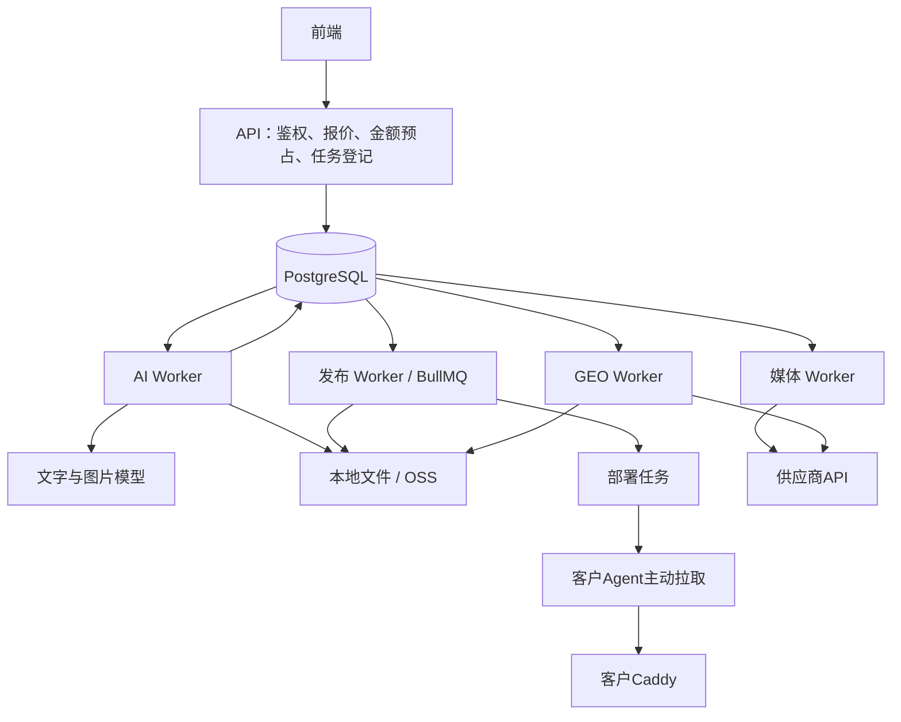

# 四类 Worker 拆分（v1.5.0）

本次发布为 v1.5.0，保留既有标签；GitHub发布不自动升级生产服务器。四类服务沿用同一后端镜像和业务模块，通过不同入口独立运行；无需拆成四套仓库、数据库或存储。

## 职责与协作

| 服务 | 入口 / 本地命令 | 执行任务 | 任务来源 |
|---|---|---|---|
| 发布 worker | pilot/worker.mjs / npm run worker | 官网构建、打包、归档、安排Agent部署；保留告警检查 | build_jobs + Redis/BullMQ |
| AI worker | pilot/ai-worker.mjs / npm run worker:ai | DeepSeek文章、百炼配图、图片持久化、AI建站及对话修改 | ai_article_jobs、website_builder_jobs |
| 媒体 worker | pilot/media-worker.mjs / npm run worker:media | 投稿、订单轮询、刊发链接 | 原媒体持久化任务 |
| GEO worker | pilot/geo-worker.mjs / npm run worker:geo | 多平台查询、状态轮询、截图归档 | 原GEO持久化任务 |

AI完成后只写入发布outbox，发布Worker随后消费；不直接运行站点构建。媒体或GEO等待供应商不会阻塞另一个服务。Provisioner继续作为独立的SSH接入执行器，职责不变。四类Worker共享PostgreSQL，拆分不消除数据库、供应商配额和存储成为瓶颈的可能。

## 图文异步接口变化

- POST `/api/sites/:site/ai-quote` 保留原报价方式。
- POST `/api/sites/:site/ai-articles` 输入仍为主题、关键词、地区、图片数量及requestKey/quoteVersion/quotedAmountCents，返回HTTP202 `{jobId,status:"queued"}`；不再等待模型生成完成。
- GET `/api/sites/:site/ai-articles/:jobId` 返回 `{jobId,status,result,error}`。成功result保持原来的article、release、mode、imageMode、imageCount、billing结构。
- 前端每1.5秒获取状态，最长等待30分钟；等待结束后后台任务继续。同一requestKey和相同输入再次提交会返回已有任务；更换输入不得复用旧编号。
- 外部调用方也需要先登记任务，再读取状态。既有同步调用方需要适配。

任务状态：queued → running → succeeded；明确失败进入failed，供应商超时或运行租约失效进入review。任务和金额预占在一个事务提交。AI结果落库时，文章、媒体记录、金额结算、发布任务、AI任务成功在一个事务提交，避免扣费与发布登记分离。图片对象先写入存储；数据库回滚可能留下未引用对象，不能将其当作成功文章，后续可增加孤立对象清理。

Worker每15秒续租，租约60秒。失联后下一次AI调度会转待核查，不自动再次调用模型，也不自动退款。queued任务可由重新启动的AI Worker继续领取。多进程通过FOR UPDATE SKIP LOCKED领取，避免重复执行。默认单AI进程逐项处理图文和建站，统一限制模型并发；多个副本尚无跨进程供应商限流，正式环境先保持一个AI副本。

## 配置与运行

本地完整启动 `npm run dev` 同时启动四类Worker及原来的API、Agent、Caddy。若检测到API已运行，启动器仍会按原逻辑退出；应先关闭旧启动会话，避免误认为已自动补齐新Worker。也可以在相同环境中分别启动上述四个命令。

生产Compose默认启动发布和AI Worker；`--profile external` 额外启动媒体与GEO。可单独用 `--profile media` 或 `--profile geo` 开启。API及Worker使用同一.env、DATABASE_URL及存储配置，所有需要本地文件的进程挂载同一platform-data:/data。媒体、GEO、AI使用PostgreSQL持久化调度；构建继续使用BullMQ与PostgreSQL outbox，不额外引入消息组件。

DeepSeek/百炼配置需同时存在于API和AI Worker：API判断报价模式，AI Worker实际调用。任务保存报价时的demo标识，配置模式变化会阻止混合内容错误扣费。保留原金额单价、预算、代理商隔离和超时待核查规则。此次不新增必须填写的业务参数。

## 升级注意

1. 备份PostgreSQL、platform-data和原.env，确认无付费生成/投稿/查询正在运行。
2. 停止旧worker和旧external-worker，再应用018迁移、构建并启动新服务。API和前端需同步升级异步契约。
3. 旧external-worker兼容入口现在仅启动媒体；GEO必须单独启动。Compose已经移除该旧服务，升级时需主动停止旧容器，防止旧混合逻辑继续抢任务。不要删除数据卷。
4. 先保持每种Worker一个副本；确认模型、OSS、媒体、GEO真实服务可用后再扩大并发。增加进程会增加数据库连接总量（每进程默认上限12）。
5. 回退代码不能撤销018产生的任务：先处理/核查未完成任务及冻结金额，不能直接让旧API绕过它们再次生成。

## 本地验证范围

- npm run test:workers：入队时不生成、并发提交幂等、并发领取唯一、图文/结算/发布闭环、运行租约丢失转review、越权拒绝，以及四个实际进程启动和任务隔离。
- npm run test:pilot：完整发布、部署、回滚、Agent、Redis恢复、AI图文与本地Caddy访问。
- npm run test:website、test:billing、test:ai、test:external、test:geo、test:frontend：现有核心链路回归。

上述测试使用隔离数据库及demo/mock供应商、本地文件；不代表真实付费模型、付费媒体投稿、正式GEO查询或云端OSS已联合验收。

