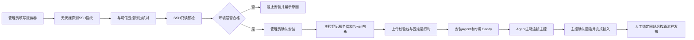
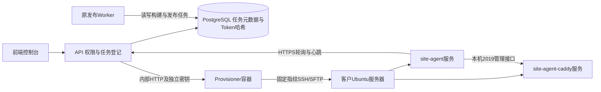

# 服务器自动接入与 Provisioner

本功能为 v1.3.5 标签后的本地开发增量，与人民币计费增量并存。未移动标签，未上传 GitHub，未连接真实客户服务器。

## 已实现范围

直营管理员可在“服务器自动接入”页面登记名称、公网 IPv4、SSH 端口、用户名及一次性密码或未加密私钥。代理商不显示此页面，接口也拒绝代理商请求。

首版支持 **Ubuntu 22.04/24.04、x86_64、root、systemd**，磁盘可用空间至少512MB，80/443/2019/4322端口须空闲。遇到现有 Nginx、Apache、Caddy、安装目录、专用用户或端口占用则停止，不接管已有业务。暂不支持 ARM、Alibaba Linux、sudo、加密私钥、IPv6，以及 NPM/已有 Caddy 共存安装。原手工接入方式仍可使用。



## 容器协作



Provisioner 是独立的接入执行器，不替代原发布 Worker。它不连接 PostgreSQL/Redis，不挂载 platform-data，不挂载 Docker socket，不开放公网端口。API 每5秒同步活动任务，即使浏览器关闭，也可根据 Agent 回连完成验收。

## 主控配置

在生产 `.env` 中填写下列占位符对应的真实值，密钥使用独立随机值，长度至少32字符。不要将该文件提交 Git。

```dotenv
PUBLIC_BASE_URL=https://control.example.com
PROVISIONER_URL=http://provisioner:4431
PROVISIONER_TOKEN=<独立随机内部认证密钥>
PROVISIONER_ALLOWED_CIDRS=<客户公网IPv4>/32
PROVISIONER_CONTROL_URL=https://control.example.com
```

- `PUBLIC_BASE_URL` 与 `PROVISIONER_CONTROL_URL` 必须是同一主控的 HTTPS 来源；后者可留空继承前者。禁止将本机数据库登记的 Token 发往另一个线上主控。
- 白名单为空时拒绝所有SSH目标。多项用英文逗号分隔，可使用单IP或 /24 至 /32网段。首选逐个IP。私网、回环、链路本地及云元数据地址始终拒绝。
- 主控容器须能出站访问客户SSH端口；客户须能访问主控HTTPS。80/443用于客户网站公网访问，2019和4322只监听本机，不需要公网开放。
- `PROVISIONER_TOKEN` 是主控与执行器间的内部密钥，与 SSH 密码、客户 Agent Token、AI API Key 不同。

在正常生产部署与迁移流程中启用可选服务：

```powershell
docker compose -f compose.production.yml --profile provisioning up -d --build
```

迁移009由原 migrate 服务顺序执行。运行前仍需准备正常生产配置；该命令不会自动升级或操作客户服务器。Compose 将 Provisioner 限定为 linux/amd64，并以非root、只读根文件系统、无Linux额外权限运行。

## 使用步骤

1. 先在执行器白名单加入客户授权的公网IP并重建/重启执行器。
2. 直营管理员进入“服务器自动接入”，填写名称、IP和SSH端口。
3. 探测主机指纹，通过可信云控制台或服务器控制台核对SHA256指纹，再勾选确认。仅从同一网络探测到的指纹不能替代可信核对。
4. 填 root 密码或未加密SSH私钥，提交只读预检。凭据提交后页面清空输入框。
5. 查看检查结果，合格后点击“确认安装专用Agent”。确认会创建两个专用低权限用户及systemd服务。
6. 等待“接入完成”。此状态要求服务安装完成且主控收到该新Token对应的Agent心跳。
7. 到原“服务器与部署”页面绑定网站，再按原流程配置域名/DNS并发布。接入不会自动绑定、发布或收费。

## 客户服务器落盘内容

| 路径/服务 | 用途 |
| --- | --- |
| `/opt/site-control` | root所有的固定Node/Caddy运行时与Agent代码 |
| `/etc/site-agent/agent.json` | Agent配置及Token，site-agent所有，权限0600 |
| `/var/lib/site-agent` | 网站版本、任务与站点文件 |
| `/var/lib/site-agent-caddy` | 专用Caddy配置、证书与状态 |
| `site-agent.service` | 以site-agent用户运行Agent |
| `site-agent-caddy.service` | 以site-caddy用户运行Caddy，仅赋予低端口绑定能力 |

`caddyAdmin=http://127.0.0.1:2019` 是客户服务器上专用Caddy的本机管理接口；不是主控地址。Agent通过它更新网站路由。Caddy用户可以读取网站文件，不能读取Agent Token配置。

安装包通过SFTP上传，逐文件SHA256校验；使用固定安装脚本，不接受浏览器提供的任意命令，不远程执行curl下载脚本。脚本先验证运行时和环境，再创建文件/用户/服务。

## 状态、失败与凭据

- SSH密码/私钥只存在执行器内存，预检凭据有效期10分钟；不存数据库、Redis、本地Storage或日志。完成、取消、失败或过期后释放引用，不宣称可以保证运行时字符串物理擦除。
- 数据库保存IP、指纹、名称、状态、检查报告及脱敏步骤。Agent Token在主控只保存哈希，明文仅传给安装执行器并写入客户配置。
- 同一请求编号避免重复登记，同一主机的活动任务互斥，安装并发最多2个。
- 执行器重启会丢失内存凭据；原任务标为状态未确认。必须先核查远端，不能盲目重新安装。
- 安装脚本可在正常失败捕获时清理本次创建的专用文件、用户和服务。SSH中断、进程被杀或机器断电无法保证远端清理完成，需管理员核查。
- 安装服务后仍未回连，或安装响应丢失，会显示失败/状态未确认；禁止自动重复安装。先检查主控HTTPS、出站网络、服务日志及远端目录。
- 若本次登记的服务器尚未绑定网站，可从任务中撤销Agent凭据。撤销阻止领取任务，不删除客户文件或卸载服务；已有网站绑定时拒绝此操作。
- Caddy能否正常申请公网证书、域名DNS以及实际网站发布仍需后续绑定发布验收，不能以“接入完成”替代。

## 本地验证与限制

`npm run dev` 启动本地执行器；Windows没有Linux安装运行时，所以可展示页面并做已授权白名单目标的预检，安装按钮禁用。本地HTTP主控同样禁止执行生产安装。不要为了试装把本地Agent Token指向生产主控。

```powershell
npm run test:provisioning
npm run test:permissions
npm test
npm run test:frontend
```

专项测试使用真实本地SSH2连接与SFTP传输，覆盖指纹不匹配、无凭据探测、IP限制、密码/私钥认证、端口冲突、凭据过期、安装确认、Token哈希、接口权限、模拟Agent回连、撤销、执行器重启等。安装与systemd响应由测试SSH服务模拟，不会操作真实云服务器。

`tests/provisioning-install.sh` 在一次性Linux容器中执行固定安装脚本，检查真实用户/文件权限、Node依赖、真实Caddy启动和Agent等待接口；systemd通过测试桩模拟，并覆盖安装失败清理。此结果不能替代真实Ubuntu/systemd服务器的最终验收。

本地已额外验证独立执行器容器以非root、只读根目录运行。由于镜像仓库拉取受限，本次容器验证使用本机已有Node24/Caddy镜像构建；生产Dockerfile需要可访问其基础镜像。尚未在真实Ubuntu云服务器执行安装或证书签发验收。
